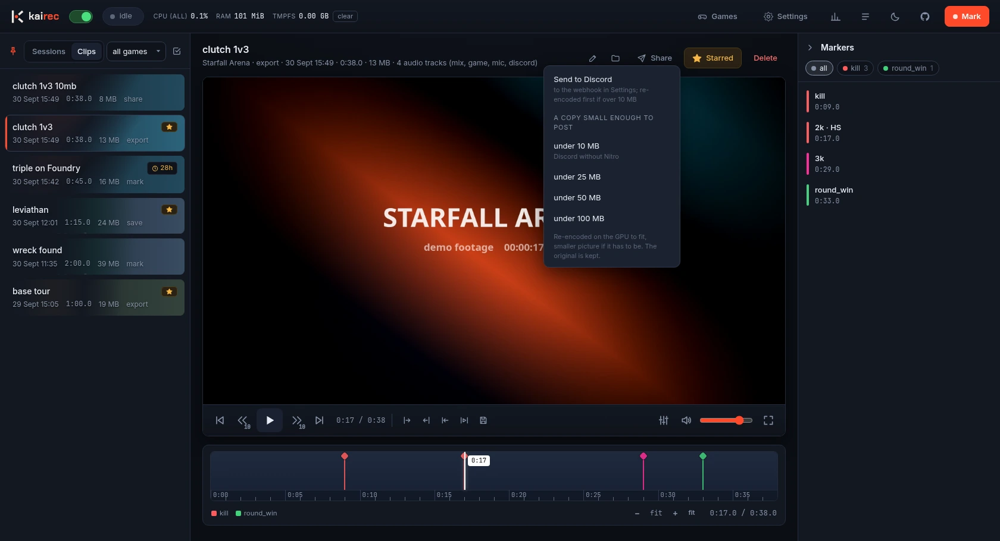
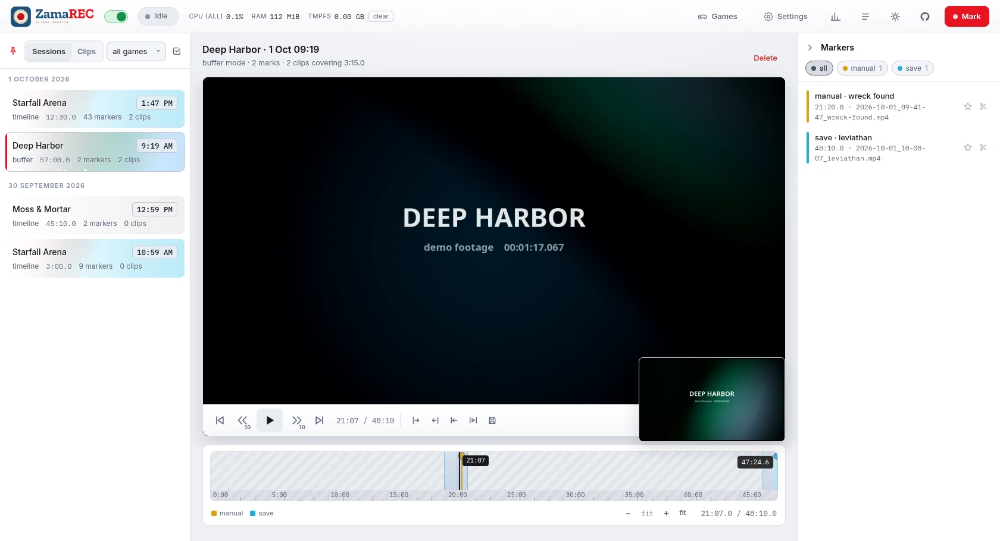

<p align="center">
  
</p>

A game session recorder for Linux (and, from the same source, Windows) built around a marker timeline. It records on its own when a game
starts, marks moments from a hotkey or from the game itself, and cuts clips from those markers
afterwards. Steam's recorder needs the overlay, which doesn't reach native Wayland games; replay
buffers give you a save key and nothing more. ZamaREC is the part after the save.


- Records automatically when a profiled game starts, on the GPU encoder, via
  [gpu-screen-recorder](https://git.dec05eba.com/gpu-screen-recorder/). Steam games you never
  set up are recorded too, to RAM only, until you keep or ignore them.
- **Timeline mode** keeps a rolling window of the last N minutes you can scrub through any time,
  even mid-session. **Buffer mode** keeps a ring buffer in RAM and writes nothing until you act.
- Markers from a hotkey, the tray, the web UI, or CS2 itself (kills with the round count, deaths,
  round results, MVPs, map changes) through Valve's Game State Integration.
- Optional separate audio tracks (game, mic, voice chat) next to the normal mix, kept in every clip,
  with a mixer in the viewer to set their levels afterwards and export a clip that sounds that way.
- Share-size copies (a clip re-encoded on the GPU to fit under 10 MB, say) and one-click posting
  to a Discord channel through a webhook.
- Clips around markers and events, saves of the last N seconds, and range exports, all as stream
  copies with no re-encode, or frame-exact on nvenc if you ask.
- A web UI with a timeline, a games page, settings, stats and a log, in a window of its own or a
  browser tab. A tray icon. A CLI.
- Stays out of the way while you play: no popups, no windows opened on their own, nothing that
  takes focus from the game. Feedback is a short tone.

> **Early software.** ZamaREC is a few days old and has been used on exactly one machine: CachyOS,
> KDE Plasma 6 on Wayland, an NVIDIA card. It records, it deletes old footage on purpose (see
> retention), and it has bugs I have not found yet. Use it at your own risk, keep anything you
> care about starred or copied elsewhere, and read the log when something looks off. Reports and
> pull requests are welcome.

Anything with systemd, PipeWire and a working gpu-screen-recorder should run it; other GPUs and
desktops are untested. There is also a Windows build, one exe plus ffmpeg, that records through
Desktop Duplication instead of gpu-screen-recorder: see [Windows](docs/windows.md).

## Screenshots

| | |
|---|---|
|  |  |
| The mixer sets the level of each separate audio track on playback, and on export. | Share posts a clip to Discord or makes a copy small enough to upload. |
|  |  |
| Games: one card per profile, plus Steam games seen without one. | The light theme, here on a buffer-mode session with a hover preview. |

The games and footage in these are made up: generated gradients, no real recordings.

## Quick start

```sh
sudo pacman -S gpu-screen-recorder ffmpeg   # Arch / CachyOS; other distros: docs/install.md
git clone https://github.com/luke-kearney/zamarec.git && cd zamarec
./install.sh
```

`install.sh` publishes the daemon, the tray and the CLI under `~/.local`, installs the `zamarec` and
`zamarec-tray` user services, and starts them. Then:

1. Open <http://127.0.0.1:3556>, go to **Settings**, check the monitor, and pick or adjust a profile.
   The default config has a `cs2` profile in timeline mode and a `minecraft` profile in buffer mode.
2. Bind two shortcuts in *System Settings → Keyboard → Shortcuts → Add New → Command*:
   `~/.local/bin/zamarec mark` and `~/.local/bin/zamarec save`.
3. Launch the game. You'll hear the start tone; the tray dot turns red. Press the mark key at a good
   moment. Quit the game and open the session in the UI.

For CS2 events, restart CS2 once after installing so it loads the generated cfg file.

## How it works, in one minute

Each **profile** is a game: a process name to watch for, a capture mode, a quality preset, and
its own clip and retention settings.

- **Timeline mode** writes 5-second segments plus a playlist. Anything older than the window is
  deleted as you play, so disk use is bounded by the window, not by how long you play. The whole
  window is scrubbable in the UI while the game is running. With `timeline.storage = "ram"` the
  segments live in tmpfs instead: no disk writes at all, at the cost of window × bitrate of memory.
- **Buffer mode** is a RAM ring buffer. A mark writes a clip covering some minutes before and after
  it; marks close together share one clip, and a mark shortly after a written clip extends it.
- A **mark** is a timestamp on the session timeline, exact to the frame in timeline mode. Manual
  marks come from the hotkey, tray or UI; automatic ones from CS2 events.
- A **clip** is an MP4 in `~/Videos/zamarec/clips/<profile>/` with a sidecar holding its own
  markers, so it can be opened in the UI and cut down again.
- **Retention** trims old and oversized sessions and clips per profile, never touching starred
  clips, sessions with starred markers or clips, or the live session.

## Documentation

- [Installing](docs/install.md): dependencies per distro, gpu-screen-recorder from Flatpak or source.
- [Configuration reference](docs/configuration.md): every key in `config.toml`, with defaults.
- [Architecture](docs/architecture.md): components, data on disk, how timing and clips work.
- [CLI](docs/cli.md): `zamarec` commands and hotkey setup.
- [Web UI](docs/web-ui.md): the timeline, editing, settings, stats and log.
- [CS2 events](docs/cs2-gsi.md): what Game State Integration gives you and how it is used.
- [HTTP API](docs/http-api.md): everything the UI talks to, for scripting.
- [Troubleshooting](docs/troubleshooting.md): the things that go wrong and what they mean.
- [Windows](docs/windows.md): the Windows build, how it differs, and how to make the bundle.
- [Development](docs/development.md) and [CONTRIBUTING](CONTRIBUTING.md).

## Requirements

| what | why |
|---|---|
| Linux with systemd user sessions, PipeWire | services and audio capture |
| gpu-screen-recorder 6.x | capture and GPU encoding (its `-ipc` and first-frame timestamp features) |
| ffmpeg 6+ | clip export, probing; nvenc for frame-exact exports |
| .NET 10 SDK | to build; the CLI is NativeAOT, so clang too |
| a Wayland or X11 desktop with a StatusNotifier tray | for the tray icon, optional |

On Windows: Windows 10 1803 or newer, a GPU with an ffmpeg encoder (NVIDIA tested; AMD and Intel wired up, untested),
and the bundled ffmpeg. Nothing to install: `packaging/windows/build.sh` makes a zip with everything in it.

## Status

Working: daemon, both capture modes, RAM timelines, hotkeys, CS2 events, web UI with timeline,
settings, stats and log, tray icon, retention, quality presets. Still on the list: a CLI export
command, real-match GSI fixtures, marker editing in the UI.

## Licence

[MIT](LICENSE). gpu-screen-recorder and ffmpeg are separate programs that ZamaREC runs; they keep
their own licences.
