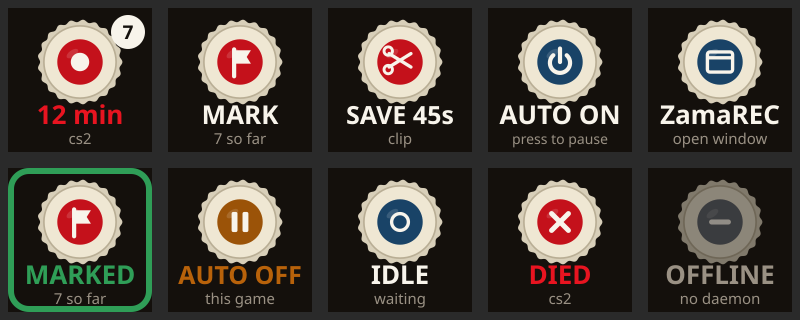
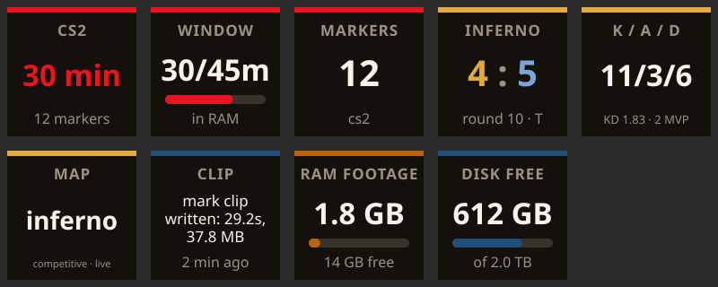

# Stream Deck and OpenDeck keys

`packaging/opendeck/com.zamarec.deck.sdPlugin` is a deck plugin with keys that show what ZamaREC is doing
and act on it. It is written for [OpenDeck](https://github.com/nekename/OpenDeck) on Linux and uses the
Stream Deck plugin protocol, so the Elgato Stream Deck app on Windows loads it too.



## Keys

| key | shows | press | hold |
|---|---|---|---|
| **Recording** | red cap and the session time while recording, the profile, a badge with the marker count; IDLE, AUTO OFF (and until when), DIED when the recorder died, OFFLINE without a daemon | stop a session; turn auto recording back on when it is off; when idle, nothing (NO GAME) unless the key names a profile to start by hand: that profile, tied to its game when it runs, or `desktop` for a desktop recording. A new RAM session drops the last session's RAM footage (10 s after it starts), hence off by default. Can be set to "stop only", "open the window" or nothing | open the window |
| **Mark** | the marker count, or the key's label; greyed out when nothing records | drop a marker (with the key's label) | open the window |
| **Save clip** | SAVE and the seconds (the key's setting, or the profile's `save_seconds`) | save the last N seconds; SAVING until the clip is written | open the window |
| **Auto recording** | AUTO ON, or AUTO OFF and until when | turn it off (for this game, 1, 2 or 8 hours, or until turned back on; set on the key); press again to turn it back on | open the window |
| **Open ZamaREC** | | open the window, or bring it to the front (`zamarec ui`) | |

| **Info display** | one thing, chosen on the key (below); made for keys that are only a screen, like the three on a Mirabox HSV293S / Ajazz AKP153 | nothing, or open the window | |



What an **Info display** key can show:

| show | value | under it |
|---|---|---|
| session time | time recording (profile on top); IDLE or AUTO OFF otherwise | marker count |
| window / buffer filled | minutes kept of the window or buffer, with a bar | in RAM or on disk |
| markers | the session's marker count | clips waiting for their "after" time |
| CS2 score | your side's score first, in its colour (CT blue, T gold); the map on top | round and your side |
| CS2 kills / assists / deaths | this map's K/A/D | K/D ratio, MVPs |
| CS2 map | the map | game mode and phase |
| last event | the newest line of the event log, its kind on top | how long ago |
| RAM footage | what the RAM dir holds, with a bar | free in that tmpfs |
| disk free | free under `storage.root`, with a bar of how full it is | the disk's size |

The CS2 views use game state integration, so they work only when that is set up (`docs/cs2-gsi.md`). They
take your own player block, never a spectated one, start over with each map, and go blank two minutes after
CS2 stopped sending. They do not need a session to be recording.

A press that worked flashes the key green with what it did (MARKED, SAVED, ...); one that did not flashes it
amber (NOT REC, FAILED, OFFLINE). The sound from the daemon is unchanged. Nothing opens or takes focus
except on a press or hold of a key that says so.

The session time moves once a minute unless the key's "count seconds" box is ticked: the deck app stores
every image it is sent, and a key redrawn every second is a write every second.

## Install

Linux, OpenDeck (native or Flatpak):

```bash
packaging/opendeck/install.sh    # ./install.sh runs this too when OpenDeck is installed
```

then restart OpenDeck. The keys are under **ZamaREC** in its action list. The plugin runs on the system's
`node`; Node 22 or newer has WebSocket built in, older ones use the small client in `ws-lite.js`. It has
no npm dependencies.

Windows, Stream Deck: open `com.zamarec.deck.streamDeckPlugin` from the Windows bundle.

## How it talks to the daemon

Like the CLI: one JSON request per connection on the control socket (`$XDG_RUNTIME_DIR/zamarec.sock`,
or `ZAMAREC_SOCKET`). On Windows, where Node cannot open that socket, it sends the same request to
`POST /api/control` on the web port instead; on Linux the key settings' **Connection** section can switch
to that too, with another address.

The status reply carries what the display keys need: the window's limit, whether the footage is in RAM, the
newest event (kept in memory by the daemon, not read back from the log file) and the CS2 match as game state
integration last described it. Storage figures walk the RAM dir, so they come only when a request asks for
them (`"storage": true`), which the plugin does every 10 seconds while a RAM or disk key is shown.

It asks for the status once a second while one of its keys is on screen and every 3 seconds while the
daemon is not there; nothing while no key is shown. That is a socket call answered from memory, nothing
that touches the GPU. A key image is only sent when it differs from the last one.

To open the window it runs the CLI (`~/.local/bin/zamarec`, `zamarec` on PATH, or the path in
**Connection**); without one it opens the UI address in the default browser.

## Changing the keys

The drawing is in `draw.js`; `node packaging/opendeck/make-icons.js` rewrites the static icons in
`icons/` from it (needs `rsvg-convert`). The cap outline is the tray icon's (`icons/rim.txt`, from
`src/ZamaRec.Tray/Icons.cs`).

Not yet tried: the Elgato Stream Deck app itself, and the Windows build with either deck app.
