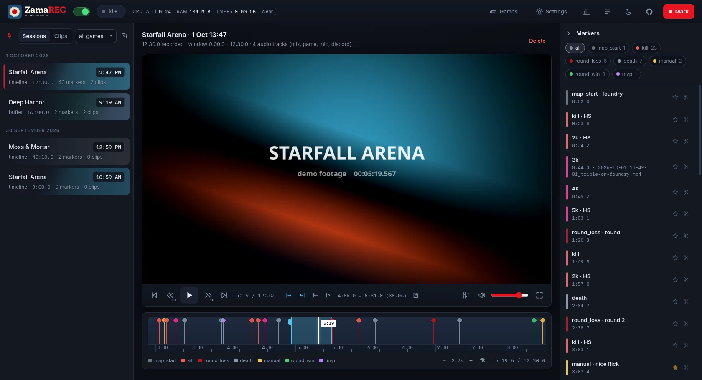
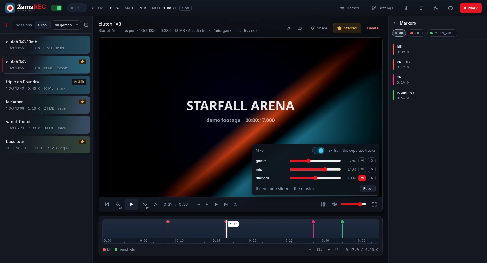
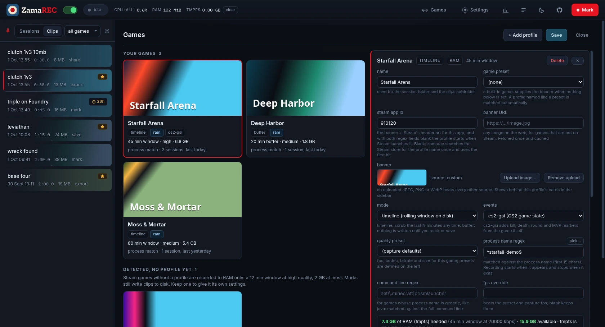

# Web UI

<http://127.0.0.1:3556>. Never opened automatically. Plain HTML and JavaScript served by the
daemon; the only library is hls.js for timeline playback.

## Its own window

The **ZamaREC** menu entry, a click on the tray icon and `zamarec ui` open the UI in a window of its
own: no tabs, no address bar, its own taskbar entry with the ZamaREC icon. It is Chrome, Chromium,
Brave, Edge or Vivaldi in app mode with a profile kept in `~/.local/share/zamarec/ui-profile`, so
it shares no extensions, tabs or history with your everyday browser. Theme, volume and mixer
levels are remembered there, separately from a browser tab. Asking again while the window is open
brings it to the front (through KWin on Plasma; elsewhere a second window opens). The window
icon in the title bar and taskbar comes from the menu entry, which `install.sh` installs under
the window's own id (`chrome-127.0.0.1__-Default.desktop`); with another `daemon.bind` address the
window works but shows a generic icon. It always opens 1680 × 910: the narrowest at which nothing in the page wraps or is cut off, with the
video at 16:9 and the timeline under it. Resize it as you like; the next open starts at that size
again.

Without one of those browsers, or with `daemon.ui_window = "browser"` (Settings → Defaults → *open
the UI in*), the page opens as a tab in the default browser. `ZAMAREC_UI_BROWSER` picks the
browser. The page also has a web app manifest, so a Chromium browser offers to install it.

## Header

- **AUTO switch**: auto recording; its light is red while on. Off opens a menu: for the rest of
  this game, for 1/2/8 hours, or until turned back on. A running session is stopped. REC and
  `zamarec start` still work.
- **Status pill**: idle, recording (profile, mode, elapsed, window), or paused with the reason.
- **cpu / ram / tmpfs**: ZamaREC's own usage, daemon plus recorder, from `/proc`. Click the CPU
  figure to switch between share of all cores and one core. **clear** drops RAM footage of finished
  sessions (asks for a second click).
- **Games**, **Settings**, then icon buttons for Stats, Log, the theme and GitHub, then **REC**:
  it starts the game that is running, else a desktop recording (`[desktop]`), and turns into
  **STOP** while recording. A game stopped this way is not recorded again until it exits or you
  press REC. **M** still drops a marker.
- **Theme button**: the page follows the OS or browser light/dark preference and switches with it.
  The button cycles auto, light, dark; a fixed choice is remembered by the browser. The video area
  and the fullscreen controls stay dark in both.

## Sessions and clips

Left column, filterable by profile. A card shows its game's banner behind it, dimmed; grey once
the footage is gone. A banner is, in order: an image uploaded for the profile in Settings, the
profile's `banner_url`, Steam's header art for its `steam_app_id` (own or the preset's), or the
first hit of a Steam store search for the profile name. The daemon fetches each once into
`<root>/banners`, so the page never contacts the internet. Badges: LIVE, RAM (segments in tmpfs), gone (RAM footage
dropped; markers and clips remain), starred, a clock with the time left on a mark clip that will
expire, and *new* for a session of a Steam game that
has no profile yet.

A clip is listed and sorted by when its footage was recorded. An export cut today from Monday's
session or clip is dated Monday, in its file name too, and sits next to what it was cut from.
Retention still counts an export's age from the day it was cut.

**Selecting several.** The tick button beside the profile filter turns clicks on cards into ticks;
shift+click ticks everything up to the last one. The bar at the bottom then stars, unstars or
deletes the ticked clips, or deletes the ticked sessions (their clips are kept; the one being
recorded cannot be ticked). Delete asks for a second click.

**Sharing several clips.** *Share* in that bar sends every ticked clip to Discord or a share module,
each as its own post or module run, one after the other (a module sees nothing new: it is started
once per clip). Each clip is re-encoded first if it is over the target's limit, and goes out with its
name as the message. The daemon runs the batch, so closing the window does not stop it; between
clips it waits while a game is being recorded (a desktop recording does not count), so no re-encode
or upload starts during play. The message at the bottom follows it ("clip 2 of 5 · sending 41%"),
and a click on it cancels the clip being sent and the rest. At the end the links are copied to the
clipboard, one per line, and the message lists any clip that was not sent and why.

## Player and timeline

- Timeline sessions play through hls.js, including the live one, a few seconds behind. Buffer
  sessions show their clips as bands on the bar; clicking inside a band plays that clip at the right
  offset. Hatched areas have no footage.
- Transport bar: previous marker, back 10 s, play/pause, forward 10 s, next marker, clock, then the
  range tools (set in, set out, jump to in, play range, the current range, and the save icon that
  opens the export panel), mute, volume, fullscreen.
- **Mixer** (the sliders button left of mute; only on recordings made with separate audio tracks):
  a panel with one row per track: level from 0 to 200%, mute (M) and solo (S). With *mix from the
  separate tracks* off, playback is the mix as it was recorded. Switched on, each track is played
  on its own at its level, in step with the video, and the volume slider and mute act as the
  master. Levels, mutes and the switch are remembered by the browser per track name, so they
  apply to every recording. A live session plays the recorded mix until it has ended. Double-click
  a level to put it back to 100%.
  
- **Exporting with the mixer's levels**: while the mixer is on, the export panel has a *mixer
  levels* box, ticked by default. An export then gets a new mix as its first track: every separate
  track at the level it has now (a muted one left out, a solo honoured), summed and limited so a
  boost cannot clip. That first track is what any player plays, so the clip sounds the way you
  heard it. The separate tracks are kept after it, and the video is still a stream copy. The
  master volume is not part of it. Applies to *Export range*, the scissors button and *Export all*.
- The bar: ruler, markers colour-coded by type, playhead, window (purged part hatched). Click to
  seek. Ctrl+wheel zooms around the mouse, wheel pans; the zoom buttons and `+`/`-`/`0` zoom centred on the playhead. The view
  follows the playhead while playing.
- **Hover preview**: rest the cursor on the bar for a moment (64 ms) and a thumbnail of
  that moment appears above it. Previews are per whole second (the keyframe there) and are made by
  the daemon only when asked, so sweeping across the bar asks for nothing; a spot already seen
  shows at once. No preview over a part with no footage.
- **In/out**: *set in* takes the playhead and sets out to in + the `len` box (30 s default);
  *set out* the other way round. Drag the handles or the whole range. *Play range* plays in to out
  and pauses at out; *jump to in* seeks to in.
- **Export panel** (save icon, or `E`): the in/out numbers, `len`, a clip label, and *Export range*,
  which writes a clip: frame-exact by default (only the frames up to the next keyframe are re-encoded,
  the rest is copied), or a plain stream copy with the box unticked, which the page remembers. Its lower row is
  **around markers**: the before/after boxes used by the scissors button on a marker, and *Export all* for every marker
  of one type. Escape or a click outside closes the panel. *Export range* closes it too; when the
  clip is written a toast says so and the in/out range and label are cleared, with the playhead left
  where it is. A failed export keeps the range and label for another try.
- A clip's title bar has a *Star* button: a starred clip never expires and is never removed by
  retention. Starring a marker (the star in its row) protects its whole session the same way.
- The rest of a clip's title bar:
  - **Rename** (pencil): edit the clip's name in place; Enter saves, Escape cancels. The file keeps
    its name, since sessions and markers refer to it.
  - **Show in folder**: opens the file manager with the clip selected.
  - **Share**: *Send to Discord* posts the clip to the webhook set under Settings → Sharing,
    re-encoding it first if it is over the channel's limit; *Send to …* does the same through each
    share module set up there ([share-modules.md](share-modules.md)). The message at the bottom
    follows the upload, a click on it cancels, and the link that comes back is copied to the
    clipboard. *A copy small enough to post*
    makes a re-encoded copy under 10, 25, 50 or 100 MB, filed as a clip of its own (source
    `share`). The original is never touched.
  - **Delete**, which asks for a second click.
- A session that has ended has a *Delete* button too: it removes the session with its markers and
  any footage still in RAM, and keeps its clips.
- **Screenshot** (camera, after the export button, or **S**): saves the frame on screen as a PNG
  under `screenshots/<game>/` in the storage root, named by when that frame was recorded, with a
  `.json` beside it. It is the exact frame, cut on the CPU from the recording, so it carries the
  recording's compression. For a game with a Steam app id a JPEG copy also goes into Steam's own
  screenshots of that game (`[screenshots].steam`): Steam shows it after it next starts, and it can
  be uploaded to the profile from Steam's screenshot view. A desktop recording or a game without an
  app id gets the PNG only.
- The export panel's size list does the same for a range: *original size* is the usual stream
  copy; a size re-encodes the range to fit under it. It goes back to original after each export.
- The marker pane collapses to a strip (chevron in its header). The sidebar has a pin, on by
  default, at the left of the Sessions/Clips switch; unpinned it collapses to a strip. Hovering that strip
  floats it over the page until the mouse leaves; clicking its strip pins it open.
- Markers pane: chips per type with counts, star toggle, click to seek. In a live buffer session a
  mark whose clip is not written yet reads "clip pending".

Keys: space, ←/→ 5 s, shift+←/→ 30 s, J/L 10 s, `,`/`.` one frame, `[`/`]` markers, I/O set
in/out, shift+I jump to in, P play range, E export panel / export, M mark, S screenshot, F fullscreen,
+/−/0 zoom.

## Games

One card per game, with its banner.

- **Your games**: the profiles. A card shows mode, storage, window or buffer length, quality, the
  RAM or disk it needs, how it is detected (process match or Steam launch) and when it was last
  played. Clicking it opens the profile's editor beside the grid: every field with helper text, a
  process picker for the match field, the banner upload, and a footprint line showing what the
  profile needs against what is available. Overrides shown depend on the mode. *Add profile* offers
  the game presets (Counter-Strike 2, Minecraft, Black Ops III) or a blank one.
- **Detected, no profile yet**: Steam games that were launched without a profile. They are recorded
  to RAM with the `[auto_games]` defaults. *Keep as profile* creates a profile with those settings
  and opens it; *Never record* puts the game on the ignore list and stops a session recording it.
- **Never recorded**: the ignore list, with *allow* to take a game off it.

Profile edits are saved with **Save**, like Settings. Keep, Never record and allow apply at once.

## Settings

Left: capture (monitor, default preset, cursor, audio sources as chips, and a switch for separate
audio tracks with a row per track: name, sources, a list to add a device or a running application
from, remove), the defaults for
unconfirmed games (on/off, RAM budget, quality, ignored app ids), sharing (the Discord webhook
address and the largest file its channel takes), and the quality presets table with GB/h. Right: defaults for timeline, buffer, clips, retention, feedback and ports.

Save applies immediately or when the current session ends; the notice says which. **Raw TOML**
edits the file directly and keeps comments. Settings and Games edit the same config: switching
between them keeps unsaved edits, and Save on either saves both.

## Stats

Lifetime footage to disk vs to RAM (buffer sessions estimated, marked ≈), clip bytes and counts,
sessions and marks, what the folders hold now, free space, and a per-session table.

## Log

Everything the daemon did: sessions, marks, clips, exports, purges, config applies, errors.
Filter chips, live follow. Also `zamarec log`.
